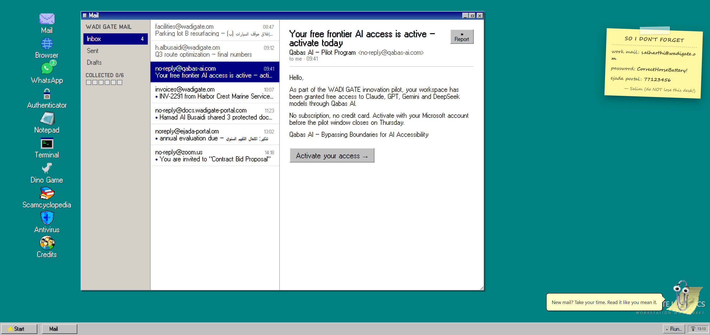
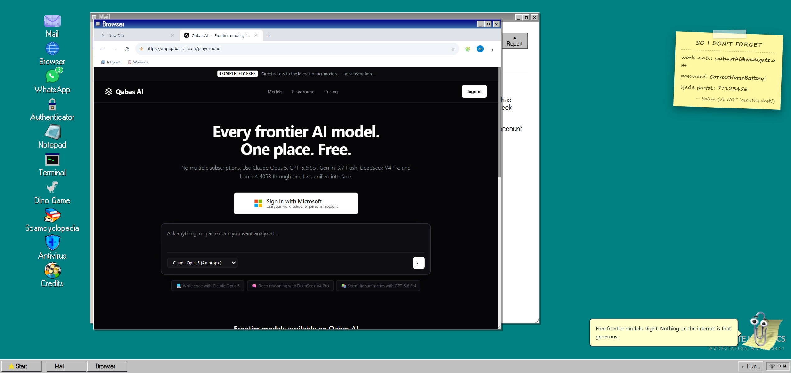

# Lure95 — Social Engineering Range

Lure95 is an interactive, browser-based **social-engineering attack simulator** built for conference booths and awareness sessions. A participant sits down at a retro Windows 95-style workstation, works through a normal shift in a mailbox and a chat app, and is hit by realistic modern attacks. There is no quiz and no "spot the red flag" checklist: **their behavior is the answer.**

After each scenario, a debrief shows what happened: an attack timeline, the technique used, its real-world prevalence, a detection view (**human tell, control, SOC signal**), and the lessons that would have stopped it.

> **Safe by design:** everything runs 100% offline in the browser. No real credentials, networks, or payloads are involved. All attacker infrastructure is simulated.

## Scenarios

| Code  | Scenario | Entry | Technique | What the participant faces |
|-------|----------|-------|-----------|----------------------------|
| SC-01 | Free frontier AI access — activate today | Mail | AiTM phishing / Browser-in-the-Browser | A "pilot program" email leads to a sign-in window that is only drawn inside the page; credentials and MFA are relayed live and the session cookie is stolen, then the screen cuts to a recording of the attacker's side |
| SC-02 | Verify you are human | Mail | ClickFix (fake CAPTCHA) | A finance-mailbox invoice link leads to a fake verification page that tells the user to paste and run a command |
| SC-03 | A teammate shared protected documents | Mail | Device-code phishing | Blurred "protected PDFs" and a genuine Microsoft device-login page; the code belongs to the attacker's device, so signing in enrolls it |
| SC-04 | Annual evaluation — action required | Mail | Subdomain spoofing (domain confusion) | A pixel-perfect clone of a government portal hosted on a free host (`ejada.gov.om.workers.dev`); only the hostname gives it away |
| SC-05 | You are invited to "Contract Bid Proposal" | Mail | Trusted-service abuse (real Zoom share, malicious file) | A genuine Zoom Docs invitation passes every email check, but the "document" it hands over is a `.js` script that installs an infostealer |
| SC-06 | Frontier AI for $10 a month | Chat (WhatsApp) | Malicious npm package with an install-time hook | A colleague forwards a post about cheap AI access; copying the install command from the docs runs a `postinstall` script that steals tokens, SSH keys and `.env` files |

The full "Start shift" experience runs them in the order SC-02, SC-01, SC-03, SC-04, SC-05, SC-06. Each scenario is defined in `stores/scenarios.ts` (lure, coach hints, attack timeline, win and lose debrief, detection and controls, sources). Its UI lives in `components/scenarios/`.

## Screenshots

| Desktop and mailbox | Scenario in progress (SC-01) |
|---|---|
|  |  |

## Features

- **Booth flow:** BIOS-style boot check ("Human firewall ... FAILED"), welcome slide, then a Windows 95 desktop (`components/booth/`)
- **Simulated desktop** with draggable windows and apps: mail, browser, terminal, notepad, antivirus, authenticator, WhatsApp, Zoom email, and the Scamcyclopedia (`components/range/`, `components/apps/`)
- **Attacker's view:** an attacker panel fills in live as the participant types. In SC-01, once the session is stolen, a full-screen **attacker POV** recording plays with a CRT glitch-in and glitch-out, and a **POV** button in the panel replays it (`components/scenarios/AttackerPov.vue`, `public/videos/attacker-pov.*`)
- **Sticky note and passwords:** the workstation's password (`CorrectHorseBattery!`) is on a sticky note on the desk. The Qabas AI, device-login and Ejada sign-in forms check it. A wrong password is rejected, the coach points at the note after two misses, and the third try is let through so nobody gets stuck (`composables/usePasswordCheck.ts`)
- **Browser keys:** a browser cannot receive the Windows key, so the coach tells visitors to press **Ctrl+R** in place of Win+R to open the Run dialog (Start, then Run also works)
- **Coach:** optional two-level hints (a nudge, then an explanation)
- **Debrief** with timeline, technique card, "old advice vs. what happened", detection view, controls, and cited sources
- **Operator console** at `/operator` for booth staff: start or skip scenarios, toggle coach hints and **Demo mode** (presenter-led: no counter, no spoilers), reset all state. Not for participants.
- **Idle reset:** after 2 minutes without input a prompt appears (150 seconds on the debrief), and if it is not answered the app returns to the start screen, so a booth stays ready for the next visitor. Set in `composables/useIdleReset.ts`.
- **Large screens:** the desktop is laid out for 1920x1080 and scaled up uniformly, so it fills a 4K TV without layout changes
- **Handout:** a one-page summary card in `docs/card.html` / `docs/card.pdf`

## Tech stack

Nuxt 3 (Vue 3, client-side SPA with `ssr: false`), TypeScript, TailwindCSS 4, Pinia.

## Running locally

Requirements: Node.js LTS and [pnpm](https://pnpm.io) (`corepack enable`).

```bash
pnpm i           # install dependencies
pnpm run dev     # dev server at http://localhost:3000
```

Production:

```bash
pnpm generate     # static SPA build
npx nuxt preview  # preview the generated build
```

For a booth, build and serve with `npx nuxt build`, then `PORT=3111 node .output/server/index.mjs`, and open it full screen at 1920x1080.

There is no test suite or linter configured; verify changes with `npx nuxt build`.

`nuxt preview` serves the last build, so rebuild after every change. On Windows the build fails with `EBUSY ... rmdir .output` if a preview server is still running; stop it first.

## Hosting

The app is a static SPA with no backend, so any static host works. The built site is about 10 MB, and the largest file is the 2.7 MB attacker video, so the free tiers' file-size limits are not a problem (Cloudflare Pages allows 25 MiB per file).

**Cloudflare Pages** (free, unlimited bandwidth, auto-deploys from `main`):

1. Workers & Pages, Create, Pages, Connect to Git, choose this repository.
2. Build command `npm run generate` (or `pnpm generate`), output directory `.output/public`. If the build fails on the Node version, set `NODE_VERSION=20`.

GitHub Pages and Netlify also work. For GitHub Pages set `app.baseURL` in `nuxt.config.ts`, because the site is served under `/<repo>/`.

At a booth, do not depend on venue Wi-Fi: run the built copy locally and use the hosted URL as a backup and for sharing. The simulated phishing pages are visible on a public URL, so keep the "training simulation" labelling on the entry screen.

## Project layout

```
components/booth/      boot check, welcome slide, entry screen
components/range/      desktop, coach, debrief, run dialog
components/apps/       simulated applications
components/scenarios/  per-scenario pages and panels
stores/                Pinia stores (scenarios, session, windows, payloads, missions)
composables/, utils/   booth state, idle reset, attacker banners and slides
pages/                 routes (/ and /operator)
docs/                  handout card (HTML and PDF) and screenshots
public/                static assets (served at site root)
```

To add a scenario, add an entry to `stores/scenarios.ts`, add it to `order`, and build its UI under `components/scenarios/`.

## Credits and origin

This project is a fork of [Doors95](https://github.com/darius-it/doors95), created by the **Beavers Testing in Production** team at Hackaburg 2025: Lev, Darius, Marinus, Matej, Jonathan. The desktop, window, and event architecture comes from their work. Lure95 replaces the educational content, scenarios, and interaction model with a social-engineering attack simulator.

The upstream repository does not currently declare a license. All rights to the original code remain with its authors; this fork is published on GitHub as a fork of their repository.
